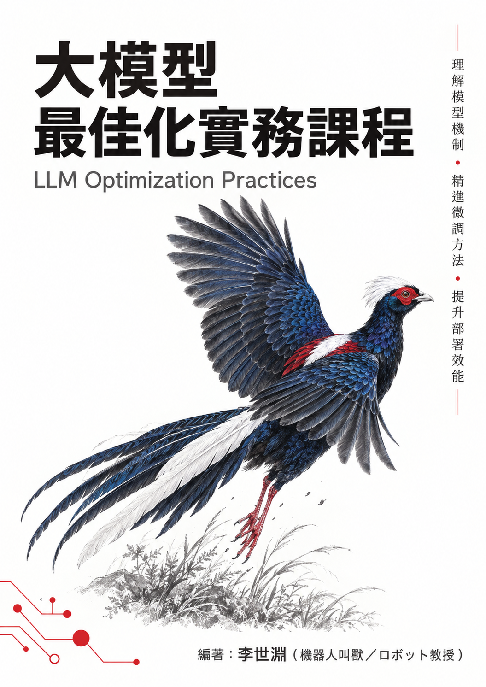

# 大模型最佳化實務課程 
大模型最佳化實務課程 (LLM Optimization Practices https://github.com/leeshihyuan/LLM-Optimization-Practices )是 大模型導論(  https://github.com/leeshihyuan/Introduction-to-Large-Language-Models )的下一步。

預設開發場景是大學端引進的 NVIDIA DGX H200 系統， GPU 記憶體總容量最高為 1,128 GBH。視覺導航無人機與人形機器人的 AI 大腦(VLM) 開發課程包含在此大語言實務內，不另行單獨成篇。

全書規劃十三篇、四十七章，每章依系列慣例採「叫獸開講→學習目標→核心概念→課文內容→案例→實作活動→延伸閱讀→章末小結→習題」結構，篇幅 15 至 20 頁。

## 第一篇　為什麼要微調（第 1–3 章）

這一篇要先把問題意識立起來：微調不是因為模型不夠好，而是因為有些東西只能寫進權重。

1. **主權 AI 的技術定義**——從「能用」到「能自己改」。界定什麼叫主權：權重可取得、可修改、可離線部署、可稽核，以及這四項各自對應到哪些技術選擇。
2. **視覺導航機器人為什麼需要大模型當大腦**——傳統導航堆疊（SLAM＋路徑規劃）的能力邊界在哪裡，語言條件式導航與開放詞彙目標搜尋補上了什麼。
3. **微調、RAG 與提示工程的分工**——本書最重要的一章。法規條文、在地統計這類事實應該走 RAG；語體、格式、拒答邊界、工具呼叫格式才該教進權重。把事實灌進 LoRA 是最常見也最昂貴的錯誤。

## 第二篇　硬體與平台（第 4–8 章）

顯存帳算錯，後面每一章都白寫。這一篇把兩座平台的物理邊界先釘死，之後所有實作都回來對照這四章的算法。

4. **顯存的四筆帳**——權重、梯度、優化器狀態、啟用值。為什麼全參數微調的記憶體是權重的六到八倍，為什麼梯度檢查點能換回大半的啟用值，以及線性注意力架構為何讓長序列的那一筆帳便宜得多。
5. **效能剖析與計算會計**（新增）——顯存只是一半，另一半是算力。MFU 的定義與量測、torch profiler 的讀法、通訊與計算的重疊、如何判斷瓶頸落在頻寬還是算力。這一章讓「這個設定好不好」從感覺變成數字，也是後續每一個實作章節的驗收工具。
6. **數值精度地圖**——BF16、FP8、NVFP4、NF4 各自的位元配置與硬體對應。本章要先把兩件常被混為一談的事切開：NVFP4 是一種需要硬體支援的加速格式，NF4 則是 QLoRA 用的權重量化方式，兩者不同層次。Hopper（H200）有原生 FP8 而無 NVFP4 路徑，Blackwell（RTX 5090）兩者皆有——但這既不代表 5090 的 FP4 能力會讓所有 4-bit 訓練受惠，也不代表 H200 不能跑 NF4 QLoRA。社群流通的 NVFP4 權重在 H200 上不會加速，這個陷阱值得一整節。
7. **RTX 5090 32GB 工作站**——Ubuntu 桌面環境、驅動與 CUDA 版本對應、PyTorch 與 Blackwell 的相容性、系統記憶體作為卸載空間的用法，以及 32GB 這條線實際擋住了什麼。
8. **H200×8 與 AI Console**——K8s 上的資源宣告（GPU 數、記憶體、共享記憶體）、排程與佇列、持久儲存掛載、節點內 NVLink 拓樸的查核，以及如何把一次長訓練寫成可重入的 Job 而不是互動式 session。這一章決定學生能不能真的用到計算中心的卡。

## 第三篇　基座模型選型（第 9–11 章）

選型是一道工程題，不是品牌偏好。這一篇把五顆模型拆開看，重點放在「架構如何決定它能在哪張卡上被微調」。

9. **稠密、稀疏與混合注意力**——三類架構的訓練成本差異。稠密模型的記憶體與算力成正比；稀疏 MoE 推論便宜卻微調昂貴（所有專家都得常駐，但每步只有少數拿到梯度）；混合注意力讓長序列的啟用值成本大幅下降。這組對比是本書的骨幹。本章同時交代檢查點類型的選擇：預訓練版（base／pt）與指令版（instruct／it）用途不同，持續預訓練通常從預訓練版出發（TAIDE 即以 Gemma-3-12b-pt 為基礎），行為微調則多從指令版出發；選錯起點，後面的資料格式與模板全都要重來。
10. **五顆基座的架構解剖**（原兩章合併）——Gemma 4 以每五層區域滑動視窗注意力搭一層全域注意力為骨架（E4B 的 42 層是 7 組、31B 的 60 層是 10 組，最後一層必為全域），E4B 用逐層嵌入把 8B 總參數壓成 4.5B 有效參數，31B Dense 相較前代 Gemma 3 27B 層數略減（60 對 62）而寬度增加，並內建 drafter。Qwen 混合線性注意力家族則是 3.5-4B 的 24＋8、3.8-27B 的 48＋16，到 Flash-Next 的三層 GDN 搭一層 QSA 加 512 專家。Flash-Next 的參數記帳要在這裡講清楚：官方模型卡寫的是 125B 主幹（每 token 啟用 6B）、另加 51B N-gram 表與 4B MTP，合計約 180B 儲存參數。「啟用 6B」描述的是每 token 的計算量，不是只需要容納 6B 權重——這是全書最適合用來破除直覺的例子。合併成一章可讓五顆模型並排比較，比分開講更能看出架構取捨。
11. **分詞器與詞表：繁中壓縮率的量測**（新增）——BPE 的運作、繁中壓縮率怎麼量、詞表擴充的流程（在目標語料上訓練 BPE、與原詞表合併去重）與其代價（嵌入層需重訓、原有能力會受擾動）。TAIDE 當年為 Llama 2 擴充了 24,720 個中文字元字詞，但 Qwen 3.8 詞表已有 248,320、Gemma 4 為 262K，結論很可能相反。本章的實作就是把五顆基座的繁中壓縮率量出來，讓學生自己判斷該不該擴充——這是全書第一個「不要照抄前人配方」的練習。

## 第四篇　資料工程（第 12–15 章）

學生最容易低估、最後卻決定成敗的一篇。課程的訊息要講白：瓶頸不是那八張 H200，是標註。

12. **資料 schema 與品質分級**——JSONL 記錄的欄位設計（對話、推理軌跡、來源授權、品質分數、任務標籤），以及為什麼主權 AI 專案的每一筆資料都要能回溯授權來源。配一支可執行的驗證器。
13. **繁體中文與在地語料**——來源盤點（政府開放資料、公開文獻、自行撰寫）、簡繁與用語校正（軟體／品質／最佳化）、公文與報告語體的樣本設計。強調 5,000 筆品質 5 勝過 50,000 筆品質 3。
14. **視覺導航資料**——影像與軌跡的對齊、動作標註的離散化、座標系與單位的約定、失敗案例的刻意收集。本章同時交代機器人資料與語言資料在 schema 上如何共存，並介紹 Open X-Embodiment 這類公開軌跡資料集的格式，以及模擬器資料與實機資料各自的取得成本、偏差與混用比例。
15. **資料清理：個資、有害內容、去重與洩漏**（原章擴充）——個資偵測與脫敏、毒性與品質分類器、台灣個資法對訓練語料的實際約束，再接 MinHash 近似去重、n-gram 重疊檢查與訓練／評測集的隔離流程。個資過濾不能拖到治理篇才提：主權 AI 要能稽核，清理流程本身就得留下紀錄。洩漏則是最容易騙過自己的失敗模式——領域分數漂亮，模型其實什麼也沒學會。

## 第五篇　參數高效微調的原理（第 16–19 章）

方法的共同基礎，兩座平台通用。先把原理講清楚，第六、七篇才不必重複解釋。

16. **LoRA 的低秩假設與其極限**——為什麼權重更新可以用低秩矩陣近似，以及這個假設在什麼情況下會破：要注入大量新知識、要改變模型的輸出分佈形狀時，低秩子空間就不夠用了。這一章也說明何時該改用全參數微調或持續預訓練，為第八篇鋪路。
17. **QLoRA、DoRA 與量化感知微調**——4-bit 基座上掛 LoRA 的運作方式、量化誤差的來源，以及哪些架構對量化特別敏感。混合線性注意力與 MoE 的量化誤差高於一般稠密模型，動態量化（對敏感層保留較高精度）是必要的補償。本章順帶對照 prompt tuning 與 p-tuning，說明為何 LoRA 家族最終成為主流。
18. **超參數**——rank 與 alpha 的縮放關係、rank 升高時學習率該如何下修、rsLoRA 的作用、warmup 與 cosine 排程、有效批量的計算。給一張依模型規模與任務類型查表的建議起點。
19. **對話模板與損失遮罩**——本篇技術密度最高的一章。各家模板的差異、thinking 模式如何渲染、為何用固定字串切分 prompt 與 response 會靜默失效，以及改用逐輪增量渲染取差集的作法。遮罩錯了不會報錯，只會訓練出一個行為奇怪的模型。現成的真實案例：NeMo AutoModel 的議題追蹤中就有人回報，Flash-Next 的模板在非推理資料上會讓「只訓練助理回覆」的遮罩對不上，空的思考區塊被算進損失。

## 第六篇　單卡實戰：RTX 5090 32GB（第 20–22 章）

每位學生都有機會親手跑完的一篇。32GB 的限制不是缺點，而是逼學生把顯存帳算準的教具。

20. **在 5090 上微調 Gemma 4 E4B**——第一個完整專案，從資料到合併匯出走一遍。Google 公布的 BF16 載入估計為 17.9 GB，但那是載入值不是微調餘裕——啟用值、梯度、優化器狀態與框架開銷都還沒算進去。本章要求學生在指定的套件版本與設定下實測，再回頭對照第四、五章的顯存帳與剖析工具，而不是拿載入估計值直接推算能開多長的脈絡。這一章刻意不走捷徑。
21. **在 5090 上微調 Qwen 3.5-4B**——混合架構的注意事項。BF16 約 10 GB，餘裕充足，可以把脈絡拉長做長文件任務。重點在線性注意力層需要對應的核心支援，以及 24 層 GDN 與 8 層全注意力在長序列下的記憶體行為差異。
22. **多模態微調：凍結的藝術**——視覺塔與語音編碼器什麼時候該凍結、什麼時候該訓練。純文字任務訓練視覺塔是白燒顯存兼破壞多模態能力；反過來，要做視覺導航就必須讓視覺塔參與。E4B 的語音編碼器則是機器人語音指令的現成管道，這一章給一個語音下令、文字回報的小實作。

## 第七篇　多卡實戰：H200×8（第 23–25 章）

從一張卡跨到八張卡，難的不是程式碼，是理解資料與參數怎麼被切開。

23. **分散式訓練的四種並行**——資料並行、張量並行、管線並行、序列並行各自切什麼、通訊量多大、何時該組合使用。以 H200×8 的單節點 NVLink 拓樸為前提討論，避開跨節點的複雜度。
24. **ZeRO 與 FSDP2 的選擇**——優化器狀態分片的三個階段、參數卸載到主機記憶體的代價、FSDP2 與 DeepSpeed 在生態系上的差異。給一張依模型規模與卡數選擇策略的決策表。
25. **微調 Qwen 3.8-27B 與 Gemma 4 31B Dense**（原兩章合併）——同一套流程跑兩顆模型，差異才看得清楚。27B 為混合注意力、BF16 約 56 GB，在 141 GB 的單卡上其實就放得下，所以本章同時給單卡與八卡配置，讓學生看見多卡換來的是脈絡長度與批量而非可行性；31B Dense 則為純稠密、BF16 約 70 GB，長脈絡的啟用值成本明顯更高。兩者並排，架構選擇在訓練成本上的差距就是一張表的事。MTP head 的凍結與合併後檢查也在這裡交代。

## 第八篇　持續預訓練（第 26–28 章）

全新增的一篇，也是原目次最大的缺口。TAIDE 的公開配方是持續預訓練、微調、人類回饋強化學習三階段，不是只做 SFT。若全書只教 LoRA 微調，學生會誤以為主權 AI 就是把開源模型拿來調語氣。

26. **CP 與 SFT 的本質差異**——SFT 教模型「怎麼回應」，CP 改的是它對語言本身的機率分佈。什麼樣的能力缺口只能靠 CP 補、什麼樣的用 LoRA 就夠，以及為什麼 CP 之後幾乎一定要重做一次對齊。
27. **語料配比與遺忘的早期徵兆**——目標語言與通用語料的比例、單輪 epoch 的理由、學習率該比 SFT 高還是低，以及如何在訓練中途就看出通用能力正在流失，而不是等到最後評測才發現。
28. **在 H200×8 上跑一次縮小規模的 CP**——本篇的實作核心。可引用的真實數字是：TAIDE 以 Gemma 3 12B 為基礎、用 46B 繁中 token 做 CP，耗 642 H200 GPU 小時、學習率 1e-4、批量 4M token、單輪。除以 8 得到的約 80 小時是理想換算，沒有計入多卡擴展效率、資料管線、checkpoint 與叢集排程，實際牆鐘時間會更長——而這個落差本身就是一堂課：學生應先在本校 H200 上做小規模實測，再外推出自己的時程。課堂版本縮到十分之一，流程完全相同，學生因此知道「完整版要多少」不是一個抽象的數字。

## 第九篇　稀疏 MoE 的挑戰（第 29–31 章）

這一篇教的是判斷力：不是每顆開源模型都該拿來微調。Qwen3.8-Flash-Next 是最好的反例教材。

29. **MoE 的路由、專家與梯度稀疏**——512 個專家、每 token 只路由 10 個加 1 個共享，於是每一步絕大多數專家拿不到梯度。但要小心別把這件事推過頭：稀疏路由下每步只有部分專家收到梯度，是架構特性，不等於微調就非得用全域大批量不可。專家並行的真正理由是權重放不下與吞吐，不是湊梯度。本章的重點放在專家並行的切法、權重放置、通訊成本與路由負載平衡；而若只在注意力與共享路徑上掛 LoRA，整個梯度稀疏問題其實就繞開了。
30. **專家並行與 N-gram 表卸載**——Flash-Next 的微調配方：張量／專家／管線三層並行的切法，51B N-gram 表的處理——它本來就設計成留在主機記憶體、以非同步預取取用，所以「卸載」是預設而非技巧。另一個要學生親手查的問題是「哪些參數真的在更新」：NVIDIA NeMo AutoModel 明載 QSA indexer 凍結、MTP head 不載入，ms-swift 文件也提到全參數訓練下有權重會靜默地不參與訓練——各框架凍結的範圍不同，不能憑印象，以及社群走的 NVFP4 專家 LoRA 路線為何需要 Blackwell。兩份原廠配方要並排讀：ms-swift 給的是 8 卡 LoRA（TP2／EP4／PP2），NeMo AutoModel 給的是僅語言路徑的全參數 SFT，驗證規模為 8 節點 64 張 H100（EP64），且不支援 TP、PP、MTP 與視覺／影片訓練。兩者切法完全不同，正好說明並行策略是框架與規模的函數，沒有唯一解。
31. **資料飛輪：把它當教師而非學生**（改寫）——約 180B 儲存參數、約 360 GB 的 BF16 權重，八張 H200 只落在 LoRA 的範圍內（且需以本校環境實測確認），全參數微調的原廠驗證規模是 64 張 H100，不在本書設備可及之處。更划算的是讓它以 4-bit 推論（每 token 僅啟用 6B，跑得很快）擔任教師。但本章不教一次性蒸餾，而是教迭代迴圈：教師出題、評測學生、針對弱點生成新課程、再微調，反覆數輪。這個形狀比單向蒸餾更接近實務，也最適合當期末專題的骨架。

## 第十篇　對齊與偏好最佳化（第 32–34 章）

SFT 教模型「怎麼說」，偏好最佳化教它「哪一種說法比較好」。對主權 AI 而言這一篇決定拒答邊界；對機器人而言，決定任務成功率。

32. **從 SFT 到偏好學習：DPO 與 ORPO**——偏好資料的成對構造、DPO 需要參考模型的記憶體代價、ORPO 把偏好項併進 SFT 損失而省下那一份權重。單卡場景下用 adapter 停用技巧取代第二份模型的作法。本章也納入台灣語境的安全測試：拒答邊界怎麼訂、對抗式提問與越權要求怎麼測、對齊前後要各跑一次並留下紀錄——主權 AI 的安全性不能只靠訓練資料裡的幾筆拒答樣本來保證。
33. **GRPO 與可驗證獎勵**——當任務的成功與否可以程式判定（導航是否抵達、工具呼叫格式是否合法、數值答案是否正確），獎勵就不必靠人標。這一章把導航模擬器的成功率接成獎勵函式，是全書兩條主線交會之處。
34. **遺忘、replay 與模型合併**（擴充）——前半談 replay 配比的實證與推理模式的保全：SFT 資料若全是短答案，thinking 模式會被壓平；領域資料佔比過高則通用能力會崩。後半談模型合併：多個 adapter 的合併、任務向量，以及第八篇的 CP 權重該如何與 SFT 權重融合。有了 CP 篇之後，這件事會自然出現在流程裡。

## 第十一篇　視覺導航機器人的 AI 大腦（第 35–39 章）

第二條主線的收束。前面所有方法在這裡套到一個會動、會撞、有時間限制的系統上。

35. **從通用 VLM 到 VLA：路線選擇**（新增）——本篇必須先回答的問題。OpenVLA 實測過全參數、僅最後一層、凍結視覺、sandwich、LoRA 五種微調策略，結論值得整節討論；OpenVLA-OFT 以 LoRA 微調在 LIBERO 取得 97.1% 平均成功率，且因為走 LoRA 而不需模型分片。本章也要誠實講：若目標是盡快拿到可用策略，從既有 VLA 基座（OpenVLA、π0、GR00T N1）出發，通常勝過拿 Gemma 4 或 Qwen 3.5 從頭做一次。選前者或後者，是教學目的與工程目的的取捨。
36. **動作空間與 tokenization**——動作要輸出成什麼？離散 token（含 FAST 這類高效動作分詞）、flow matching、或結構化工具呼叫。三種設計對訓練資料、解碼延遲與安全檢查的影響各不相同。教學場景建議採結構化工具呼叫，因為它可被驗證、可被攔截。
37. **把導航任務寫成對話**——指令、觀測、動作、失敗回報的四段式格式。多輪導航如何表示、影像觀測如何穿插、模型說「我看不清楚」時該怎麼接。資料 schema 與第 14 章一致。
38. **從機房到機上：三段式壓縮**——蒸餾（27B 教 4B）、剪枝、量化依序施作，每一段都量測能力損失。目標硬體設定為機上運算模組，說明為什麼 4B 級的混合注意力模型是目前這個位置最合理的選擇。
39. **即時性預算**——延遲、決策頻率、安全停機。大模型的推論延遲是數百毫秒等級，不可能進入控制迴路；正確的架構是大模型做規劃與語意判斷、傳統控制器做即時反應。這一章劃清分工，並把界線落到實際堆疊上：語言模型輸出的是目標與約束，ROS 2 與 Nav2 負責路徑規劃與避障，底層控制器負責即時反應，中間以工具呼叫與狀態回報銜接。也要說明當大腦遲遲不回應或失聯時，機器人該退回哪一層行為。

## 第十二篇　評測、量化與上線（第 40–44 章）

微調完不等於做完。這一篇教學生如何證明自己真的改善了，而不是只在自己在乎的那個指標上進步。

40. **三軌評測：方法論與架構**——領域軌（開放式生成加評分準則）、回歸軌（通用能力是否被打壞）、推理軌（thinking 模式是否還活著）。只跑領域軌是最常見的自我欺騙：領域分數上升、模型整體變笨，而你看不到。門檻怎麼訂是本章核心：不同基準的尺度與變異不同，不能一律用「掉三個百分點就不發布」。正確作法是先建基線、隔離測試集、重複測量取信賴區間，再依應用風險決定各軌容忍度；三個百分點只是示範用的起點，不是通則。
41. **台灣在地基準的實作與批判**——TMMLU+（66 學科、總計 22,690 題；TAIDE 模型卡的評測口徑為 20,118 題，引用時要註明用的是哪一個）、TMLU、Taiwan Truthful QA、Legal Eval、TW MT-Bench，以 lm-evaluation-harness 執行。但本章真正要教的是懷疑：TMMLU+ 的題目多可追溯至單一線上題庫，污染風險高；而且在其上使用思維鏈提示反而會讓多數模型表現下降，暗示它測的偏向知識檢索而非推理。兩個對照基準給出不同排名時該信哪一個，沒有標準答案——這正是學生該練的判斷。
42. **機器人評測：成功率、碰撞率與人工接管**（新增）——語言基準量不到機器人的好壞。本章建立第二套指標：任務成功率、碰撞率、人工介入次數、端到端延遲，以及跨場域測試（換場地、換光照、換起點後還剩多少成功率）。安全類指標與能力類指標的門檻必須分開訂——碰撞率的容忍度不該和分數退步用同一套邏輯。模擬器成績與實機成績的落差本身也是要量測的對象。
43. **訓練後量化與推論加速**——FP8 與 4-bit 的取捨、哪些模組不該量化（視覺塔、MTP head、路由器）、MTP 投機解碼帶來的吞吐提升，以及量化後必須重跑第 40 與 42 章評測的理由。
44. **上線與監看：多適配器服務**——以 vLLM 服務化、在 AI Console 上以 K8s 部署、回歸看板的指標設計。本章的重點是一顆基座掛多個 adapter：本書雙主線恰好對應同一顆 27B 同時服務主權 AI 與機器人兩個任務，這也是一間學校用有限硬體支撐多個專案的標準作法。同時交代一件常被忽略的事：訓練與服務不能共用同一張卡。

## 第十三篇　治理與結課（第 45–47 章）

全書收尾。主權不是把權重下載下來就有了，而是要能說清楚這顆模型由什麼構成、受什麼條款約束、出事時怎麼追。

45. **授權盡職調查與資料主權**——Apache 2.0、Gemma 使用條款與 Qwen Community License 1.0 的實質差異：哪些允許商用、哪些要求標示、哪些對衍生模型有附加義務。授權要逐一核對各模型當前發布的模型卡版本，不以家族概括——Gemma 4 現為 Apache 2.0，與舊版 Gemma 條款不同。再談訓練資料本身的授權鏈，以及為什麼第 12 章的 schema 要強制記錄每一筆資料的來源與使用權。
46. **模型卡、版本治理與教學單位的 MLOps**——模型卡與資料卡該寫什麼（資料組成、評測結果、已知限制、不建議的用途）、權重與 adapter 的版本管理、實驗紀錄的最小可行作法，以及在 AI Console 這類共用叢集上，一個實驗室如何讓三年後的學弟妹重現今天的結果。
47. **結課專題：雙主線整合任務**——主權 AI 組與機器人組各一個可評分的整合任務，附評分標準與班內排行榜。本書的雙平台設定讓這件事特別好玩：兩組學生用不同硬體競爭同一組指標，5090 組靠資料品質與方法取勝，H200 組靠規模，誰贏不一定。排行榜式的作業設計在 Stanford CS336 上行之有年，值得一試，但效果如何仍應以本班的實際投入情況檢討。

## 附錄與建議的編寫順序

### 附錄

- **附錄 A　環境與版本相容性查核表**——RTX 5090 的驅動與 CUDA 版本對應、H200×8 的 AI Console Job 範本。更重要的是建立一個全書共用的格式：每一個實作章開頭都附一張表，列出模型 ID 與 commit、Transformers／PEFT／訓練框架／推論框架版本、GPU 數與配置、資料集版本、已知限制。各基座對這些版本的要求並不一致，寫成表格才能隨軟體更新逐章修訂，而不必重寫正文。
- **附錄 B　顯存與吞吐速算表**——五顆基座 × 四種精度 × LoRA／全參數的查表，每格同時留「理論估計」與「實測」兩欄。理論值用來規劃，實測值用來修正——書中所有估計值都應被學生的實測覆蓋。
- **附錄 C　資料 schema 與驗證器**——完整欄位定義與可執行的驗證程式。
- **附錄 D　評測 harness**——語言三軌與機器人指標的完整程式，以及基線報告格式。
- **附錄 E　AI Console 校內操作查核表**——GPU 配額、單次可申請的卡數、PVC、節點拓樸可見度、Job 時限，全由校方叢集設定決定。正文只寫通用的 K8s 概念，這些會變動的校內規則集中放在這裡，方便每學期更新。
- **附錄 F　常見故障對照表**——症狀、可能原因、處置。例如 loss 一開始就趨近零多半是遮罩沒生效；領域分數升而回歸軌崩多半是 replay 比例太低。
- **附錄 G　術語對照**——英中對照，依系列慣例採台灣用語。

### 建議的編寫順序

不建議依章號順序寫。建議先把兩條實作主線打通，再回頭補理論，因為實作過程會不斷修正你對理論章節該講多深的判斷：

1. **先寫第 20、25 章**——一單卡、一多卡的完整實作。這兩章跑通後，第二篇的顯存帳與效能會計、第五篇的超參數建議才有真實數字可填。
2. **再寫第四篇與附錄 C**——資料 schema 定下來，後面所有實作章節才能共用同一組範例資料。
3. **接著第 40 章與附錄 D**——評測先立起來，第六、七、八、九篇才有共同的成效比較基準。
4. **然後跑第八篇的 CP 實驗**——這是唯一需要長時間獨佔計算中心資源的一篇，排程要提早談。實驗跑著的同時可以寫第二、三、五篇這些理論章節，此時已有實測數字可引用。
5. **第十一篇最後寫**——視覺導航主線依賴前面所有方法，且需要模擬環境配合，開發週期最長。
6. **第一、十三篇收尾**——問題意識與治理，全書完成後回頭寫，立場會更準確；結課專題也要等前面所有實作定稿才訂得出合理的評分標準。

另有一個與課程同步的考量：第六篇只需要工作站，第七、八、九篇都要排到計算中心的卡，其中第八篇的持續預訓練佔用時間最長。若課程與寫書並行，把第六篇排在學期前段、第七篇排在中段、第八篇的 CP 實驗安排在期中之後，可以避開計算中心期末的排隊尖峰。

## 依國際課程與原廠資源的檢討（2026-11-13）

對照 Stanford CS336、NVIDIA DLI／NeMo 的教材結構、VLA 微調文獻與 TAIDE 的公開訓練配方後，原 40 章版的目次有九個缺口（下表章號為當時的舊編號，九項均已在上方目次處理）。其中第一與第二項是結構性的，不補會讓全書對「主權 AI」的教法失準。

| 缺口 | 佐證 | 建議處置 |
| --- | --- | --- |
| **完全沒有持續預訓練（CP）** | [TAIDE](https://huggingface.co/taide/TAIDE-LX-7B) 的公開配方是 CP → 微調 → RLHF 三階段，不是只做 SFT。[Gemma-3-TAIDE-12b](https://huggingface.co/taide/Gemma-3-TAIDE-12b-Chat) 以 46B 繁中 token 做 CP，耗 642 H200 GPU 小時 | 新增一篇。642 GPU 小時除以八張 H200 約 80 小時，但這是未計擴展效率與排程的理想換算，實際時程要以本校實測外推 |
| **沒有 tokenizer 與詞表章節** | CS336 第一講即是 tokenization；TAIDE-LX-7B 額外擴充 24,720 個中文字元字詞 | 第三篇新增一章。重點不是「要擴充」，而是「先量測繁中壓縮率再決定」——Qwen3.8 詞表 248,320、Gemma 4 為 262K，已遠大於 Llama 2，結論可能與 TAIDE 當年相反 |
| **沒有效能剖析與計算會計** | CS336 整個 Assignment 2 在做 profile 與 benchmark，並把 resource accounting 當習慣養成 | 第二篇新增一章：MFU、吞吐量、torch profiler、瓶頸定位。目前只算顯存不算算力，少了一半 |
| **個資與有害內容過濾缺席** | CS336 資料作業含 PII 脫敏、NSFW／毒性分類、品質分類器 | 併入第四篇。主權 AI 要能稽核，個資過濾不能拖到治理篇才提 |
| **評測缺台灣在地基準與批判** | TMMLU+ 含 22,690 題、66 學科；但其題目多可追溯至單一線上題庫，污染風險高，且在其上使用 CoT 反而使多數模型表現下降 | 第 36 章擴成兩章。納入 TMMLU+、TMLU、Taiwan Truthful QA、Legal Eval、TW MT-Bench，以 lm-evaluation-harness 執行，並教學生懷疑指標本身 |
| **VLA 篇過於概念化** | [OpenVLA](https://arxiv.org/html/2406.09246v3) 實測了全參數／最後一層／凍結視覺／sandwich／LoRA 五種策略；[OpenVLA-OFT](https://openvla-oft.github.io/) 在 LIBERO 取得 97.1% 平均成功率 | 第十篇補一章實證配方與基準，並誠實處理一件事：目次假設從通用 VLM 做成 VLA，但實務常從既有 VLA 基座（OpenVLA、π0、GR00T N1）出發 |
| **缺多適配器服務** | NVIDIA NeMo 的核心用例之一是一顆基座掛多個 LoRA | 第 38 章補一節。本書雙主線恰好對應：同一顆 27B 同時掛主權 AI 與機器人兩個 adapter |
| **蒸餾只講一次性** | NVIDIA 的[資料飛輪](https://developer.nvidia.com/blog/fine-tuning-small-language-models-to-optimize-code-review-accuracy/)是出題→評測→針對弱點生成課程→微調的迭代迴圈 | 改寫第 28 章為迭代式，這也更適合當期末專題 |
| **沒有整合專題與排行榜** | CS336 五個作業各有 leaderboard | 新增結課專題一章，兩條主線各訂一個可評分任務 |

## 本次修訂做了什麼

上方目次已是修訂版。原稿 12 篇 40 章，經兩輪修訂後成為 13 篇 47 章：新增 9 章、合併省回 2 章。（第一版異動表寫成「新增 10 章、合併 4 章」，加總與章數對不上，已更正——把擴充既有章節誤記為合併是算錯的原因。）
